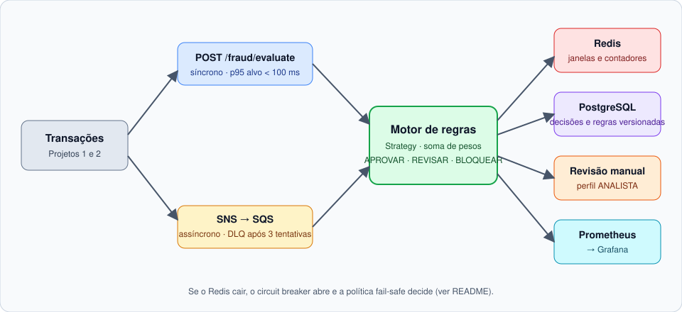
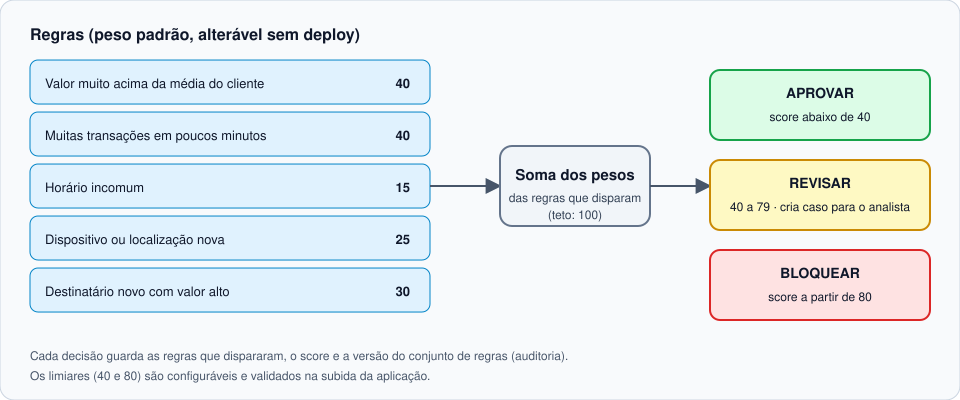
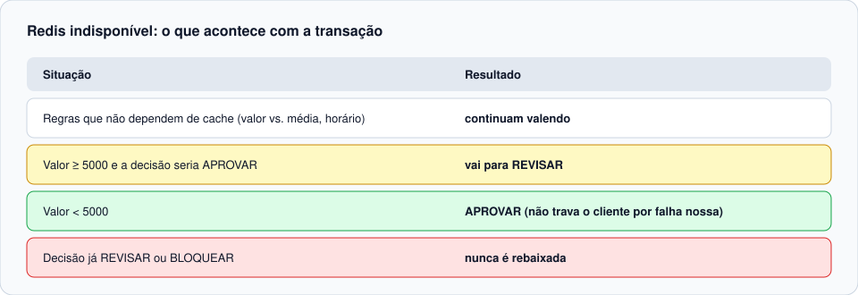

# FraudGuard — antifraude em tempo real

Avalia cada transação (Pix, cartão, transferência) contra regras de risco e devolve `APROVAR`, `REVISAR` ou `BLOQUEAR` com score e motivos. Spring Boot 4 / Java 21, PostgreSQL, Redis, SNS+SQS (LocalStack), Micrometer + Prometheus + Grafana.



## Rodando

```bash
cp .env.example .env             # troque TODAS as senhas (16+ caracteres); .env nunca é versionado
docker compose up --build        # app :8080, Grafana :3000, Prometheus :9090, LocalStack :4566 (só em 127.0.0.1)
curl -u "service:$FRAUD_SERVICE_PASSWORD" -H 'Content-Type: application/json' localhost:8080/fraud/evaluate -d '{
  "transactionId":"t-1","customerId":"c-1","amount":150.00,"channel":"PIX",
  "deviceId":"d-1","location":"BR-SP","recipientId":"r-1"}'
docker compose --profile loadtest run --rm k6     # carga: 200 req/s, falha se p95 >= 100 ms
mvn verify                                        # unitários + Testcontainers + gate de cobertura
```

Usuários (HTTP Basic, em memória, senhas obrigatórias via variáveis de ambiente): `service` (avalia), `analista` (fila de revisão), `admin` (regras). As métricas (`/actuator/prometheus`) e o health ficam na porta de gestão 8081, que o Compose não publica. Em produção: JWT/mTLS e SSO; veja [SECURITY.md](SECURITY.md).

## API

| Endpoint | Perfil | Função |
| --- | --- | --- |
| `POST /fraud/evaluate` | SERVICE | Decisão síncrona. Idempotente por `transactionId` |
| `GET /cases?status=ABERTO` | ANALISTA | Fila de revisão manual |
| `POST /cases/{id}/approve` · `/block` | ANALISTA | Resolve o caso (uma vez; 409 se já resolvido) |
| `GET /admin/rules` · `PUT /admin/rules/{code}` | ADMIN | Ativa/desativa, muda peso e parâmetros **sem deploy** |

Eventos assíncronos: publique o mesmo JSON do endpoint no tópico `transaction-events`; a `fraud-queue` (com DLQ após 3 tentativas) alimenta o mesmo motor. A decisão é idempotente, então avaliar via HTTP e via fila não duplica nada.

## Decisões de projeto

**Motor de regras (Strategy + Open/Closed).** `FraudRule` tem uma implementação por classe em `rules`. O `RuleEvaluator` recebe *todas* as implementações por injeção, soma os pesos das que dispararam (teto 100) e compara com os limiares (`>= 40` REVISAR, `>= 80` BLOQUEAR). Nova regra = nova classe `@Component` + uma linha em `fraud_rule`; nada existente muda. Uma regra que lança exceção é ignorada e registrada, sem derrubar a avaliação.



**Regras versionadas.** Peso, `enabled` e `params` ficam em `fraud_rule`. Alterar = inserir nova linha com `version` maior (nunca UPDATE). O conjunto vigente fica em memória (recarregado a cada 30 s e na hora em que é alterado), então o caminho crítico não consulta o banco por regras. Cada decisão grava `rules_fired`, `score` e `ruleset_version`: dá para reconstruir por que uma transação foi bloqueada meses depois.

**Janela deslizante no Redis.** Um único pipeline por avaliação: `ZADD` (timestamp, membro = `transactionId`, logo reenvios não contam em dobro) + `ZREMRANGEBYSCORE` + `ZCARD`, mais `SADD`/`SCARD` para dispositivo, localização e destinatário conhecidos. O primeiro valor visto é linha de base, não "novo".

**Política fail-safe (Redis fora).** Timeout de 100 ms e circuit breaker (Resilience4j: abre com ≥50% de falhas em 10 chamadas; meia-abertura após 10 s). Com o Redis indisponível:

| Situação | Resultado |
| --- | --- |
| Regras que não dependem do cache (valor vs média, horário) | continuam valendo |
| Valor `>= 5000` e decisão seria `APROVAR` | **`REVISAR`** |
| Valor `< 5000` | **`APROVAR`** (não travamos o cliente por falha nossa) |
| Decisão já `REVISAR`/`BLOQUEAR` | nunca é rebaixada |



A decisão registra o motivo `FAILSAFE_CACHE_UNAVAILABLE`. Limiar em `fraudguard.failsafe.high-amount`. Com o circuito aberto, a resposta degradada sai sem esperar o timeout. Testado em `EvaluationIT` (Redis congelado de verdade) e `GuardedVelocityStoreTest` (abertura do circuito). Conexão com o Redis é aquecida na subida.

**LGPD.** Decisão guarda só `transaction_id`, score, motivos e versão. No Redis, cliente/dispositivo/local/destinatário entram como hash SHA-256 truncado, com TTL. Logs mascaram ids (`Masker`) e nunca imprimem o corpo do evento. `customerId` deve ser um identificador interno pseudonimizado, nunca CPF. O perfil só aprende com transações aprovadas.

**Observabilidade.** `fraud_evaluation_latency_seconds` (histograma com bucket em 100 ms), `fraud_decisions_total`, `fraud_rule_fired_total`, `fraud_failsafe_activations_total` e estado do circuit breaker. Dashboard em `infra/grafana/dashboards/fraudguard.json` (provisionado automaticamente).

## Testes

- Um teste unitário por regra, com bordas (limites inclusivos/exclusivos, janela que atravessa meia-noite, cache indisponível).
- `RuleEvaluatorTest`: parametrizado com combinações de regras/pesos/limiares.
- `EvaluationIT`: PostgreSQL + Redis via Testcontainers; decisão, idempotência, fila de revisão e perfis, mudança de regra sem deploy, fail-safe.
- `mvn verify` falha se a cobertura de linhas de `rules` + `evaluation` ficar abaixo de 85% (JaCoCo).
- Carga: `loadtest/evaluate.js` (k6) com threshold `p(95) < 100 ms`.

## Resultado do teste de carga (honesto)

**A meta de p95 < 100 ms NÃO foi atingida** no único ambiente em que medi: Docker Desktop no Windows (12 vCPUs), com outros contêineres alheios ao projeto consumindo CPU ao mesmo tempo. Alvo: 200 req/s por 60 s.

| Execução | Vazão sustentada | p95 | Observação |
| --- | --- | --- | --- |
| 1 (antes da correção) | ~15 req/s | 21,5 s | BCrypt em toda requisição (ver abaixo) |
| 2 (após a correção, JVM fria) | ~100 req/s | 4,3 s | |
| 3 (JVM aquecida) | ~160 req/s | 2,5 s | |

- **Bug real encontrado pela carga:** o `InMemoryUserDetailsManager` regravava as senhas `{noop}` em BCrypt no primeiro login, e cada requisição passava a pagar ~200 ms de hash. Corrigido em `SecurityConfig` (encoder com `noop` como id de escrita).
- **Ainda aberto:** mesmo após a correção, o app saturou a CPU (~6 vCPUs) a ~100-160 req/s. Com isso o Redis estourou o timeout de 100 ms, o circuit breaker abriu e a maioria das decisões saiu pelo fail-safe (o que confirma que a política funciona sob estresse, mas invalida a medição do caminho feliz). A fila do executor assíncrono de atualização de perfil também acumulou (~700 tarefas).
- **Próximos passos:** perfilar com JFR; limitar/dimensionar o executor do `ProfileUpdater`; reduzir idas ao banco por requisição (hoje: perfil, busca por idempotência, insert da decisão); repetir a medição em máquina dedicada. Só então publicar um p95.

## Limitações conhecidas

- Autenticação simplificada (Basic em memória) de propósito: BCrypt custaria dezenas de ms por chamada.
- O perfil (média móvel) é atualizado de forma assíncrona e sem lock; é aproximado por natureza.
- `usual_hours` é cadastrado manualmente; sem ele vale a faixa noturna padrão.
- Terraform/ECS Fargate não incluídos; a imagem do `Dockerfile` é o artefato de deploy.

## Demo online (Vercel)

O simulador roda sem senha. Na Vercel, `api/index.py` (Python, só biblioteca padrão) reimplementa o motor de regras para a demonstração. Não é o serviço Java: não há PostgreSQL, Redis nem autenticação, e o estado fica na memória da função (some quando a Vercel a recicla). Se a função não responder, o simulador usa o mesmo motor em JavaScript no navegador. Testes: `python -m unittest discover -s tests_api`.
